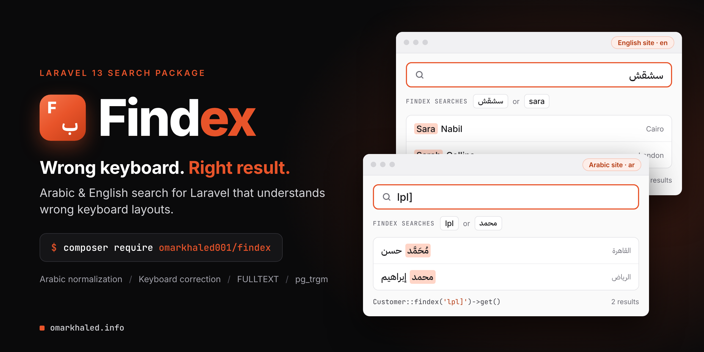
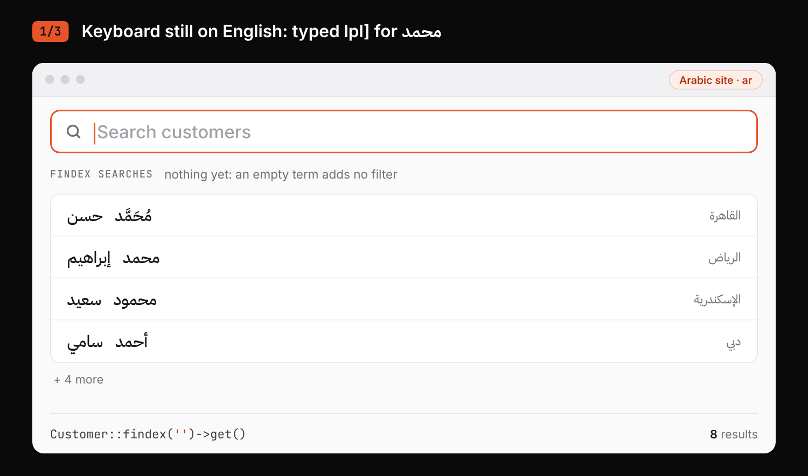

<p align="center">
  
</p>

# Findex

**Fast Arabic & English search for Laravel that understands wrong keyboard layouts.**

```php
Product::findex('محمد')->get();    // finds "مُحَمَّد", "محمد" and "محـمد"
Product::findex('lpl]')->get();    // finds "محمد" too: the keyboard was still on English
Product::findex('اثممخ')->get();   // finds "Hello": the keyboard was still on Arabic
```

<p align="center">
  
</p>

<sub>The search box is a mock-up. The variants and results in every frame are what the package returned for that keystroke.</sub>

[](https://github.com/OmarKhaled001/findex/actions/workflows/tests.yml)
[](LICENSE)

- [Why](#why)
- [Install](#install)
- [Quick start](#quick-start)
- [How normalization works](#how-normalization-works)
- [Keyboard correction](#keyboard-correction)
- [Drivers and indexing per database](#drivers-and-indexing-per-database)
- [Reindexing](#reindexing)
- [Config reference](#config-reference)
- [Optional integrations](#optional-integrations)
- [Limitations](#limitations)

## Why

Searching Arabic text with a plain `LIKE` fails in ways users notice immediately:

- `احمد` does not find `أحمد`, `مدرسه` does not find `مدرسة`, `محمد` does not find `مُحَمَّد`.
- `١٢٣` does not find `123`, and `cafe` does not find `Café`.
- Someone types `lpl]` because the keyboard was still on English, and gets nothing.

Findex fixes all three without a search server:

1. **One canonical form.** Stored text and search terms go through the same normalizer, so they always meet.
2. **Wrong-layout correction.** Every word is also searched as the same keys would read on the other layout.
3. **Speed.** Text is normalized once, when a row is saved, into one indexed column. A search never
   transforms stored data: it is a `LIKE` or `MATCH` against that column, and it can use a FULLTEXT
   or trigram index.

Requirements: PHP 8.3+ and Laravel 13. No other dependency: no Scout, no `intl` extension.

## Install

```bash
composer require omarkhaled001/findex
```

The service provider and the `Findex` facade are discovered automatically. Publishing the config is optional:

```bash
php artisan vendor:publish --tag=findex-config
```

## Quick start

**1. Add the index column**

```php
Schema::table('products', function (Blueprint $table) {
    $table->findex();                  // nullable text column "search_index"
    // $table->findex(fullText: true); // + FULLTEXT index (MySQL / MariaDB)
    // $table->findex(trigram: true);  // + GIN trigram index (PostgreSQL)
});
```

**2. Tell the model what to index**

```php
use Illuminate\Database\Eloquent\Model;
use OmarKhaled\Findex\Attributes\FindexColumns;
use OmarKhaled\Findex\Concerns\Findexable;

#[FindexColumns(['name', 'sku', 'description', 'category.name'])]
class Product extends Model
{
    use Findexable;
}
```

**3. Index the rows you already have**

```bash
php artisan findex:reindex Product
```

**4. Search**

```php
Product::findex($request->q)->paginate();

Product::where('active', true)->findex($request->q)->latest()->get();

DB::table('products')->whereFindex('search_index', $request->q)->get();
```

Every word must match, in any order. An empty term adds no constraint, so `findex($request->q)` is safe
on a listing page with an optional search box.

### What can be indexed

| Column | Example | Notes |
| --- | --- | --- |
| A real column | `'name'` | |
| An accessor | `'full_name'` | Rebuilt on every save, see below |
| A relation attribute | `'category.name'` | Dot notation, any depth: `'category.parent.name'` |
| Many related rows | `'tags.*.name'` | Uses `data_get()`, so wildcards work |
| An array / JSON attribute | `'meta.keywords'` | Needs an `array` cast; nested values are flattened |
| A translatable attribute | `'title'` | With [spatie/laravel-translatable](https://github.com/spatie/laravel-translatable), **every** locale is indexed |

Arrays, collections, JSON strings, backed enums and `Stringable` objects are flattened to text.
Booleans and whole related models are skipped.

Instead of the attribute you can override a method:

```php
public function findexColumns(): array   // the list of columns
{
    return ['name', 'sku'];
}

public function toFindexText(): string   // or the raw text itself
{
    return $this->name.' '.$this->brand->name;
}
```

These replace methods of the trait, so do not mark them with `#[\Override]`. If you override
`toFindexText()`, keep `findexColumns()` accurate as well: it is what the change detection below relies on.

A model can use its own index column: `#[FindexColumns(['name'], index: 'needle')]`.

### When the index is rebuilt

The trait listens to the model's `saving` event:

| Situation | Index |
| --- | --- |
| New model | Built |
| A source column changed | Rebuilt |
| A source is an accessor or a relation | Rebuilt on every save, because it cannot be checked for changes |
| The model was loaded without one of its source columns (`select('id', 'stock')`) | **Left alone**, so a partial model never wipes it |
| Nothing relevant changed | Left alone |

`$model->syncFindexIndex(force: true)` rebuilds the column in memory regardless; `$model->buildFindexIndex()`
returns the value without setting it.

Writes that fire no model events do not update the index: `saveQuietly()`, `Model::withoutEvents()`,
`insert()`, `upsert()` and query-builder `update()`. Neither does a change to a *related* model: renaming
a category does not touch its products. Run [`findex:reindex`](#reindexing) after those.

> **Tip:** the index column is an implementation detail. Keep it out of your API responses with
> `#[Hidden('search_index')]` on the model.

## How normalization works

Both the indexed text and the search term go through the same pipeline, four native calls with no
per-character PHP loop: `mb_strtolower` → one `strtr` with a table compiled once → one `preg_replace` → `trim`.

| Rule | Option | Input | Result |
| --- | --- | --- | --- |
| Alef forms | `alef` | `أحمد إسلام آدم` | `احمد اسلام ادم` |
| Ta marbuta | `ta_marbuta` | `مدرسة` | `مدرسه` |
| Alef maqsura | `alef_maqsura` | `مستشفى` | `مستشفي` |
| Hamza on waw / yeh | `hamza` | `مؤمن سائل` | `مومن سايل` |
| Tashkeel and tatweel | `diacritics` | `مُحَمَّد` `محـــمد` | `محمد` |
| Arabic and Persian digits | `digits` | `١٢٣ ۴۵۶` | `123 456` |
| Latin accents | `latin_accents` | `Café Straße Æther` | `cafe strasse aether` |
| Definite article (off by default) | `strip_definite_article` | `البيت الكبير` | `بيت كبير` |
| Kept symbols (none by default) | `preserve` | `C# C++` | `c# c++` with `['#', '+']`, otherwise `c c` |

Always applied:

- Lowercase.
- Punctuation and whitespace become a single space: `SKU-123` → `sku 123`.
- Invisible characters are removed: zero-width (non-)joiners, directional marks, soft hyphen, BOM.
- Persian `ک` `ی` become Arabic `ك` `ي`: `کتاب علی` → `كتاب علي`.
- Lam-alef ligatures (`ﻻ` `ﻷ` `ﻹ` `ﻵ`) become two letters.

A standalone hamza (`ء`) is a letter of its own and is kept.

The result only contains letters, digits, combining marks, single spaces and the characters you chose
to preserve. **It can never contain `%`, `_` or `\`**, which is why Findex binds terms into `LIKE`
without escaping them, and why those three characters are refused in `preserve`.

```php
Findex::normalize('أَهْلًا بِكُمْ فِي الْمَدْرَسَةِ!');   // "اهلا بكم في المدرسه"
```

The index column stores the *result* of these rules. After changing any of them, run `findex:reindex`.

## Keyboard correction

A word is searched as typed **and** as the same keys read on the other layout. The layouts are
Arabic (101 / PC) and US QWERTY.

| Typed | Also searched as | |
| --- | --- | --- |
| `lpl]` | `محمد` | |
| `hgfdj` | `البيت` | |
| `hgsghl ugd;l` | `السلام عليكم` | each word on its own |
| `Hpl]` | `أحمد` | Shift + H types `أ` |
| `اثممخ` | `hello` | |
| `مشقشرثم` | `laravel` | |
| `هحاخىث` | `iphone` | |
| `لاخسف` | `bost` and `ghost` | `لا` is the **B** key, and also **G** then **H** |

The original word is always kept, so a correctly typed term is never lost. Alternatives are computed
on the raw word, before normalization, because punctuation keys carry letters (`]` is `د`, `;` is `ك`).

Which direction is tried depends on `findex.keyboard.mode`:

| Mode | Latin word also tried as Arabic | Arabic word also tried as English |
| --- | --- | --- |
| `auto` (default), Arabic locale | yes | no |
| `auto` (default), any other locale | no | yes |
| `ar` | yes | no |
| `en` | no | yes |
| `both` | yes | yes |
| `off` | no | no |

In `auto` mode a locale is Arabic when it starts with one of `findex.keyboard.arabic_locales` (default
`['ar']`, which covers `ar`, `ar_EG` and `ar-SA`). The locale is read on every search, never cached.

```php
app()->setLocale('ar');

Findex::parse('lpl] iphone');
// [['lpl', 'محمد'], ['iphone', 'هحاخيث']]
// A row matches when it matches one variant of every group.

Findex::toArabicLayout('lpl]');     // "محمد"
Findex::toEnglishLayout('اثممخ');   // ["hello"]
Findex::toEnglishLayout('لاخسف');   // ["bost", "ghost"]
```

Uppercase letters without their own Arabic Shift letter map like the lowercase key, and for the six
that have one (`H Y N G T B`) both readings are tried, so caps lock and mobile auto-capitalization
do not break a search.

## Drivers and indexing per database

| | `like` (default) | `fulltext` |
| --- | --- | --- |
| SQL | `search_index LIKE '%word%'` | `MATCH (search_index) AGAINST ('+(word* alt*) +(word2*)' IN BOOLEAN MODE)` |
| Matches | any part of a word | the start of a word |
| Databases | all | MySQL, MariaDB (everything else falls back to `like`) |
| Index that helps | PostgreSQL trigram | FULLTEXT |

```php
Product::findex($q)->get();                       // the configured driver
Product::findex($q, driver: 'fulltext')->get();   // for this call
```

Indicative timings on a 200,000-row table (about twelve words per row, one small machine, MySQL 8.0
and PostgreSQL 16). Absolute numbers will differ on your hardware; the ratio is the point:

| Search | MySQL | PostgreSQL |
| --- | --- | --- |
| One word, `like`, no index | 218 ms | 49 ms |
| One word, FULLTEXT index (`fulltext` driver) | 0.16 ms | |
| One word, trigram index (`like` driver) | | 0.25 ms |
| Two words with layout alternatives, no index | 374 ms | 65 ms |
| Two words with layout alternatives, indexed | 0.42 ms | 0.70 ms |

Each word becomes one `AND` condition, the variants of a word are `OR`'d, and everything sits in a
single pair of parentheses:

```sql
-- Product::findex('lpl] 15'), Arabic locale
select * from "products"
where (("products"."search_index" like ? or "products"."search_index" like ?)
  and "products"."search_index" like ?)
-- bindings: %lpl%, %محمد%, %15%
```

### MySQL and MariaDB

`LIKE '%word%'` cannot use a B-tree index, so it scans the table: roughly a millisecond per thousand
rows in the measurement above. When that is no longer fast enough, add a FULLTEXT index and switch
the driver:

```php
$table->findex(fullText: true);
```

```dotenv
FINDEX_DRIVER=fulltext
```

What to know:

- **Prefix, not substring.** `phone` finds `phones` but not `smartphone`.
- **Short words.** InnoDB does not index words shorter than `innodb_ft_min_token_size` (default 3).
  Findex searches those with `LIKE` in the same query. Keep `findex.fulltext.min_token_length` equal
  to the server setting.
- **Stopwords.** InnoDB does not index its stopwords (`the`, `with`, `for`, ...) either, and a required
  word that is not in the index matches nothing. Findex therefore sends the built-in InnoDB stopword
  list through `LIKE` as well; `findex.fulltext.stopwords` holds the list.
- **Phrases.** A term that normalizes to several words (`SKU-123` → `sku 123`), or a wrong-layout word
  whose keys include punctuation, is searched with `LIKE`.
- **Still one query.** When at least one word uses the index, MySQL narrows by `MATCH` first and applies
  the `LIKE` conditions to the remaining rows.
- **Transactions.** InnoDB updates a FULLTEXT index on commit. Rows inserted inside a still-open
  transaction, as in tests using `RefreshDatabase`, are not visible to `MATCH` yet.
- The index is a `TEXT` column (64 KB). For very long content, declare a `longText` column yourself
  instead of calling `$table->findex()`.

### PostgreSQL

A GIN trigram index makes `LIKE '%word%'` fast while keeping substring matching, so stay on the
`like` driver:

```php
DB::statement('CREATE EXTENSION IF NOT EXISTS pg_trgm');   // once per database, needs the privilege

Schema::table('products', function (Blueprint $table) {
    $table->findex(trigram: true);
});
```

```sql
create index "products_search_index_trigram" on "products" using gin ("search_index" gin_trgm_ops)
```

- **The extension must exist first**, otherwise the migration fails with
  `operator class "gin_trgm_ops" does not exist for access method "gin"`.
- Laravel compiles `LIKE` on PostgreSQL as `"search_index"::text like ?`. On a `text` column that
  cast is a no-op and the index is used.
- The database needs a UTF-8 `LC_CTYPE`. With `LC_CTYPE = 'C'`, pg_trgm ignores non-ASCII letters and
  Arabic terms fall back to a sequential scan (results stay correct). Check with
  `select show_trgm('محمد');`: it must not return `{}`.
- Trigrams need three characters. One- and two-character terms are still answered correctly, by a scan.

### SQLite

`LIKE` only. `fullText: true` and `trigram: true` are skipped without an error, so the same migration
runs everywhere, and the `fulltext` driver falls back to `like`. This is the setup used by the test suite.

## Reindexing

```bash
php artisan findex:reindex Product                      # short names resolve to App\Models
php artisan findex:reindex Product "App\Models\Post" --chunk=1000
```

Or from code:

```php
use OmarKhaled\Findex\Reindexer;

$updated = app(Reindexer::class)->reindex(Product::class, chunk: 1000);
```

Reindex:

- after installing Findex on a table that already has rows;
- after changing the indexed columns of a model, or any `findex.normalization` option;
- after writes that fire no model events, or changes to related models (see [above](#when-the-index-is-rebuilt)).

It reads rows with `chunkById`, without global scopes (soft-deleted rows included), eager-loads the
relations your columns go through, and writes each chunk in one transaction straight through the query
builder: no model events, no `updated_at` change. Rows whose index is already correct are skipped, so
it is cheap to run again. It returns, and the command prints, the number of rows it updated.

## Config reference

| Key | Default | |
| --- | --- | --- |
| `column` | `search_index` | Name of the index column |
| `driver` | `like` | `like` or `fulltext`. Env: `FINDEX_DRIVER` |
| `fulltext.min_token_length` | `3` | Shortest word the FULLTEXT index stores |
| `fulltext.stopwords` | InnoDB defaults | Words the FULLTEXT index does not store. `[]` if the server has stopwords disabled |
| `keyboard.mode` | `auto` | `auto`, `ar`, `en`, `both`, `off`. Env: `FINDEX_KEYBOARD_MODE` |
| `keyboard.arabic_locales` | `['ar']` | Locale prefixes treated as Arabic in `auto` mode |
| `normalization.alef` | `true` | `أ إ آ ٱ` → `ا` |
| `normalization.ta_marbuta` | `true` | `ة` → `ه` |
| `normalization.alef_maqsura` | `true` | `ى` → `ي` |
| `normalization.hamza` | `true` | `ؤ` → `و`, `ئ` → `ي` |
| `normalization.diacritics` | `true` | Remove tashkeel and tatweel |
| `normalization.digits` | `true` | `٠-٩` and `۰-۹` → `0-9` |
| `normalization.latin_accents` | `true` | `é` → `e`, `ß` → `ss` |
| `normalization.strip_definite_article` | `false` | Remove a leading `ال` when three letters remain |
| `normalization.preserve` | `[]` | Characters kept inside words, e.g. `['#', '+']` |
| `max_tokens` | `10` | Words of a term that are searched; the rest is ignored |

The service is a singleton that reads this configuration once, when it is first used, and holds no
request state, which makes it safe under Octane. If you change `findex.*` at runtime, for example in
a test, rebuild it with `app()->forgetInstance(\OmarKhaled\Findex\Findex::class)`.

## Optional integrations

Findex depends on none of these packages. The snippets are starting points for your own code.

### Filament

```php
use Filament\Tables\Columns\TextColumn;
use Illuminate\Database\Eloquent\Builder;

TextColumn::make('name')
    ->searchable(query: fn (Builder $query, string $search) => $query->findex($search)),
```

To reuse it, register a macro in a service provider:

```php
TextColumn::macro('findexable', function (): static {
    /** @var TextColumn $this */
    return $this->searchable(
        query: fn (Builder $query, string $search): Builder => $query->findex($search),
    );
});

TextColumn::make('name')->findexable(),
```

One `findexable()` column per table is enough: the index column already covers every source column.

### Livewire

```php
use Livewire\Attributes\Url;
use Livewire\Component;
use Livewire\WithPagination;

class ProductSearch extends Component
{
    use WithPagination;

    #[Url]
    public string $q = '';

    public function updatedQ(): void
    {
        $this->resetPage();
    }

    public function render()
    {
        return view('livewire.product-search', [
            'products' => Product::findex($this->q)->paginate(12),
        ]);
    }
}
```

```blade
<input type="search" wire:model.live.debounce.300ms="q" placeholder="ابحث...">
```

### Laravel Scout

Use the normalizer on both sides so your search engine gets the same canonical text:

```php
use OmarKhaled\Findex\Facades\Findex;

public function toSearchableArray(): array
{
    return [
        'id' => $this->id,
        'name' => Findex::normalize($this->name),
        'description' => Findex::normalize($this->description),
    ];
}
```

```php
Product::search(Findex::normalize($request->q))->get();
```

For wrong-layout input, `Findex::parse($request->q)` gives the variants of every word to build an
engine-specific query from.

## Limitations

- **Two layouts only:** Arabic (101 / PC) and US QWERTY. No Arabic (Mac), AZERTY or Persian layout.
- **No typo tolerance.** There is no fuzzy matching or edit distance: `mohamed` does not find `mohammed`.
- **No stemming and no ranking.** `كتب` does not find `كتاب` unless it is a substring, and results come
  back in your query's order, not by relevance.
- **Drivers match differently.** `like` matches anywhere in a word, `fulltext` only at the start.
- **The definite article option is simple.** It removes a leading `ال` only, not `وال`, `بال` or `لل`.
- **Accessor sources and partial selects.** For a real column, Findex sees that it was not selected and
  leaves the index alone. It cannot see which columns an accessor reads, so select them when you save
  a model that indexes one.
- **`لا` beyond three.** A wrong-layout word with more than three `لا` sequences is tried with all-`b`
  and all-`gh` readings only.

## Testing

```bash
composer test    # Pest, SQLite in memory
composer lint    # Pint
```

## License

MIT. See [LICENSE](LICENSE).
